## Mazda MX-5 NA Speaker Panel Reverse Engineering and Modification

---

A Reflection of the reverse engineering process of the speaker panels on the 1990s Mazda MX-5 NA.

### Table of Contents

### Aim

- Obtain a usable stl of the part from the 3D scanner
- Learn new concepts and pathways to an end design
- Modification of the scanned part to fit a different size speaker
- Modification of the 3D printer to print carbon fiber filaments

### Results

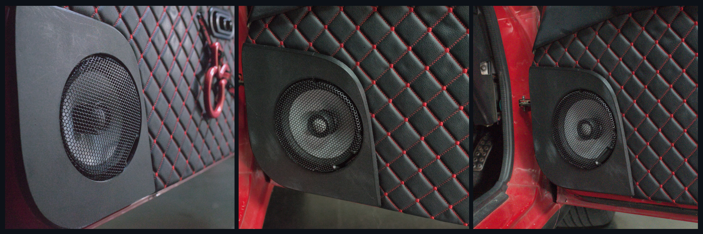

### Tools and Software

- 3D Scanner: [Creality Raptor Pro](https://www.creality.com/products/creality-raptor-pro)
- 3D Scanner Software: [CrealityScan](https://wiki.creality.com/en/software/scan-software)
- 3D Modelling Software: [Fusion 360](https://www.autodesk.com/products/fusion-360/overview)
- Slicing Software: [Cura ultimaker](https://ultimaker.com/software/ultimaker-cura/)
- 3D Printer: [Ender-3 S1 Plus](https://www.creality.com/products/creality-ender-3-s1-plus-3d-printer)

## Scanning

---

The overall priority was obtain the rough shape of the panel using the 3D scanner and software. Reducing the amount of conceptual knowledge required and time taken to produce a workable result.

##### Scanning

The original passenger panel was scanned on a flat table with markers both on and around the panel. The panel was scanned using the parallel laser lines setting to an approximate resolution of 0.2mm.

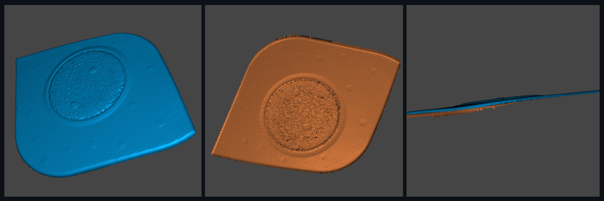

The opposing side was scanned with an approximate resolution of 0.5mm

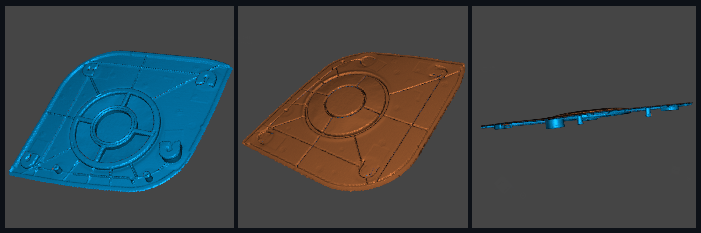

##### Fusing

After scanning both faces the scans were edited deleting the excess points from the point cloud such as the background or other objects in the scan. Additionally points that may mislead the fusing algorithm were also removed from the point cloud. here

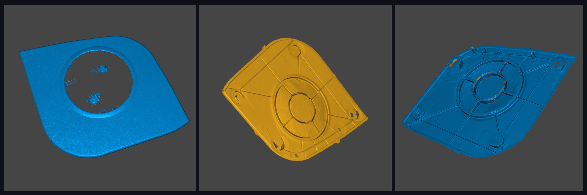

The scans were subsequently fused to create a mesh model representing the estimated geometry of the part. Due to the nature of algorithms used in the fusion process artifacts can appear in the mesh. These artifacts particularly occur near edges of the point cloud scan and intricate areas where insufficient data was obtained in the scanning process. To prevent these artifacts from causing further discrepancies in the aligning and meshing process they were deleted from the mesh model.

##### Aligning

The initial two scans done did not contain enough common features and the auto aligning algorithm could not arrange the two scans correctly. The manual alignment system did not achieve the required result either. To address this issue two additional scans were completed with the part stood on its side edge supported by a metal rack. Artifacts from the metal rack were deleted and the two news scans were fused.

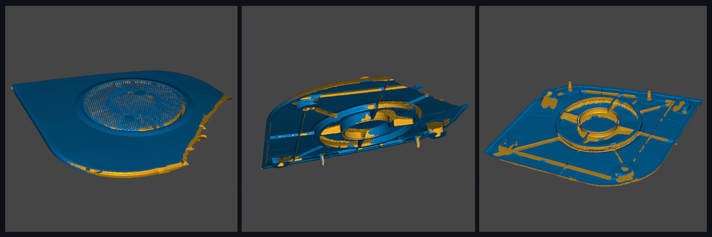

Scans 3 and 4 were able to help the algorithm correctly align all four scans resulting in a visual representation of a single body from the layered scans. The individual scans were then consolidated into a singular mesh model through the stitching process.

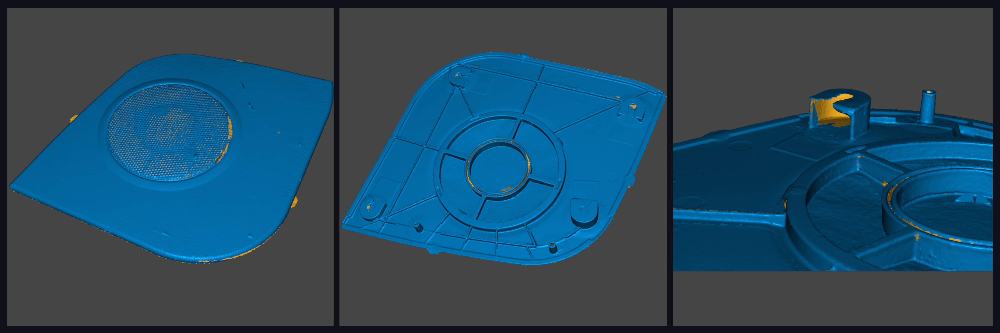

##### Mesh Processing

The scanner was having issues with the grill due to pass through of the lasers. This caused excess complexity of triangles and meshing within this area. As the mesh is not part of the Speaker panel it is a metal plate, the parts of the mesh were deleted and filled reducing the number of triangles and complexity.

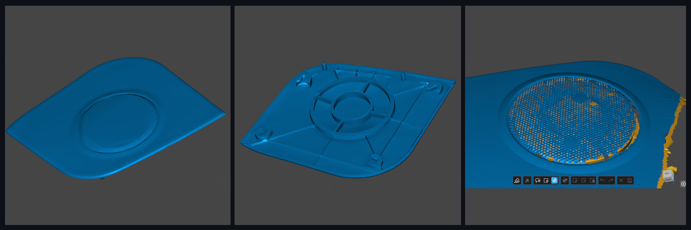

##### Results & Conclusion

The resulting scan turned out well with majority of the geometry required. Extra photos and measurements were required in the modelling process.

The excess number of triangles in an unimportant region caused the modeling within fusion 360 to throttle and have large processing times. Covering or removing the grill before scanning the part may be a better option in the future. Although the aim was to create a rough scan of the object not a detailed one. it is would be beneficial in the future to learn and use the local area scan option within the software to improve the details of complex parts.

## Reverse Engineering and modification

---

The priority in this section was to create a 3D printable version of the panel and fix areas of the 3D model that were not scanned correctly. Additionally modify the center of the panel to allow for the fitment of a larger speaker, modify certain sections of the design to improve print-ability and functionality.

##### Importing and Reducing

The part was imported into fusion 360 as mesh, reduction of the mesh and a mesh repair was used to redistribute the triangles and the parts complexity. This was done to further reduce processing times when interacting with the model. Due to the variability of the hole sizes and locations of the original part. It is estimated to have a tolerance of ± 2mm or even greater in some areas, meaning the reduction in mesh quality has no effect on the parts use. The mesh was converted to a body to allow for padding and cutting operations.

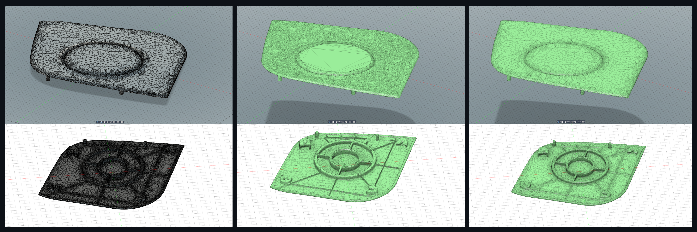

##### Fixing and Modifying

Three of the four clips on the bottom side of the panel were assumed to lie on the same plane, as such a three point plane was constructed with a reference from each clip. Taking references from the original part and the digital scan sketches of the clip holders were created before padding/extruding the designs from the body. the key-way on the clip holder that the clip sits in was reduced slightly in size in comparison to the original. The reduction in size will likely limit the free-play in the panel and potential rattling from vibrations. Cutting operation was done on the perimeter of the clip holder to remove irregular faces before adding fillets to certain edges. The fillets were added to improve the print-ability of the clip and reduce stress caused by stress raisers. The fourth clip holder was on a different plane, however the geometry of the clip holders apart from their heights were all identical. Subsequently the sketch was copied and the same operations were completed.

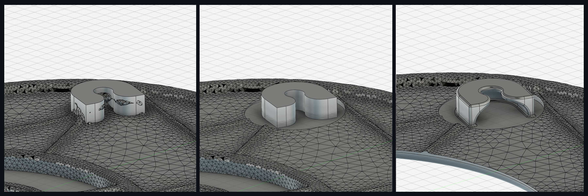

To reconstruct the locating pins a perpendicular plane was created using a face on the side of the cylinder as a reference. A extrude and cut operation were then conducted on each to the correct size and removing the irregular faces from the perimeter respectively. Small fillets at the base of the cylinders were added to reduce stress concentration.

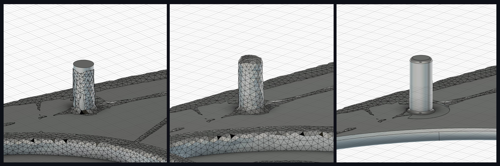

The front face of the scanned part varied in height at all points, initially it was attempted to maintain the warped geometry of the part from the scan. However, printing attempts proved unsuccessful with poor adhesion and bridging. These issues could have been addressed with supports, although this would increase the time required to de-burr and finish the part. After deliberation with stake holder of the project “why don’t you just make it flat“, it was decided to do just that using the loft process. The three highest points on the top of the part were used as references to create a plane for the flat face sketch. Following this, new planes were created, offset into the model. The intersections between the body and planes were projected onto respective sketches. For each projected sketch a new sketch was created tracing the projection with poly lines. The poly line sketches were then combined using the loft feature, and merged with the body. Modifications were then made on each poly line layer to smooth curves and improve its print-ability.

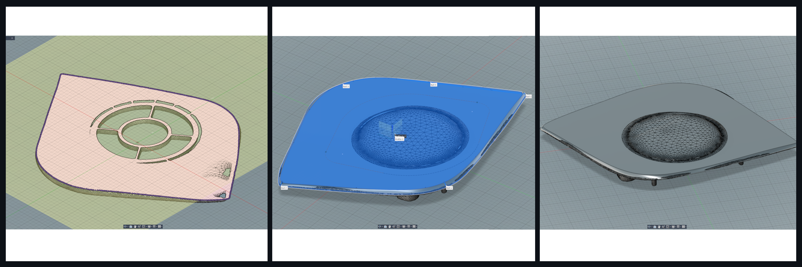

A three points around the speaker grill plastics were used to create a plane approximate to the speakers direction. A sketch was created on this plane and various circles with the same center point were created and aligned with the circular features on the part. This process allowed the center of the speaker to be found. Using the same center point another circle was created and cut from the part to fit the 6 inch speakers.

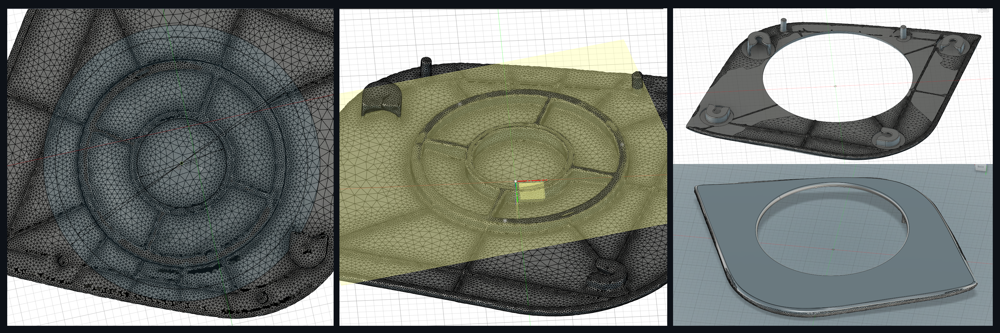

##### Results and Conclusion

The final model turned out well enough with no major issues. Improvements could be made to the curves in some areas of the part, to maintain similarity around all of the sides. Further effort could be placed into the full recreation of the model rather than the manipulation of the scanned model. However, time placed into that may not achieve anything required for the scope of this project. The original part had ridges checkered across the bottom side, likely to support its structure and stiffness. These ridges dissipated in the reduction of the mesh, and were not manually recreated. The 3D printed part did not seem to lack structural integrity, if any issues arise in the future these ridges may be replaced.

## 3D printing

---

To produce an aesthetically pleasing part, with little need for cleaning and finishing able to withstand the environment of a modern day vehicle.

##### Printer Modifications

The part in this case is being used in an exposed environment, likely in direct sunlight and will experience high temperatures (40-50°C) in the summer season. The material chosen by the client was PETG-CF, for its balance between strength, weather resistance, usability and cost. The carbon fibre in PETG-CF has a high hardness, one of the qualities that that improves its durability. However, this also causes it to damage softer materials such as brass. Hence, the 3D printer required modifications to support the use of this material, namely the upgrade of its throat, nozzle and build plate. It also required an encloser and extraction fan for temperature stability and health and safety.

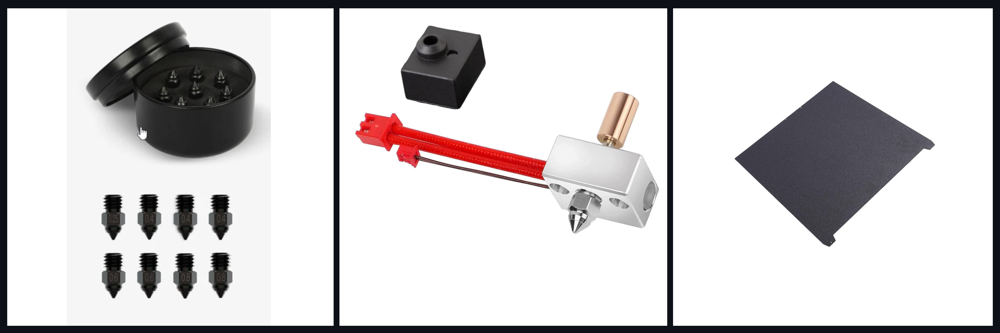

##### Printing

A test print with PLA was conducted to ensure the part was within tolerance before printing with the more expensive material. The print turned out well needing no dimensional modifications. Following this the part was printed with PETG-CF, using rough guideline settings found online. Slight stringing issues and inconsistencies in the layers occurred in the printing process. Changes to the layer height quality and in-depth adjustments to the correct setting for the material and printer would reduce these issues. The final result was still visually pleasing, without any modification or supports needed.

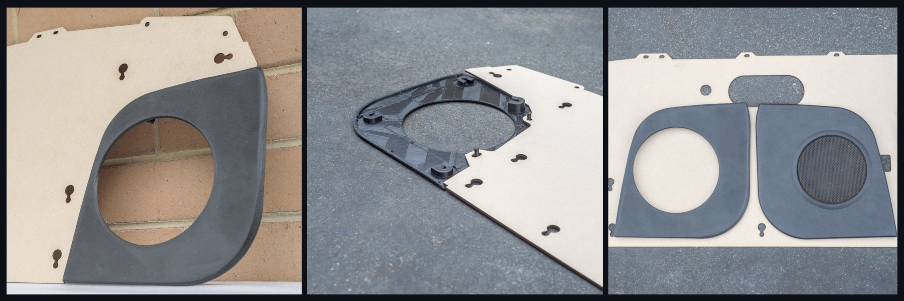

##### Conclusion

This project was a great learning experience, if I were to attempt it again I would be able to significantly reduce the time spent and further develop processes for reverse engineering. I was challenged with hardware and software I was unfamiliar with and discovered more capabilities within the software I have been using for a few years. The documentation has been a difficult process, managing my expectations, motivation and the scope of the project. Overall I believe the this reflection has improved my critical thinking and I have retained more of the knowledge I learnt in the project. I wish to continue these and further develop the process of reflection with future projects.

Thanks for reading
Tiranicle

## AI Declaration

No AI was used in this project at any point

## Files attached

- Cura export printer settings profile
- Scanned stl profile
- Images
